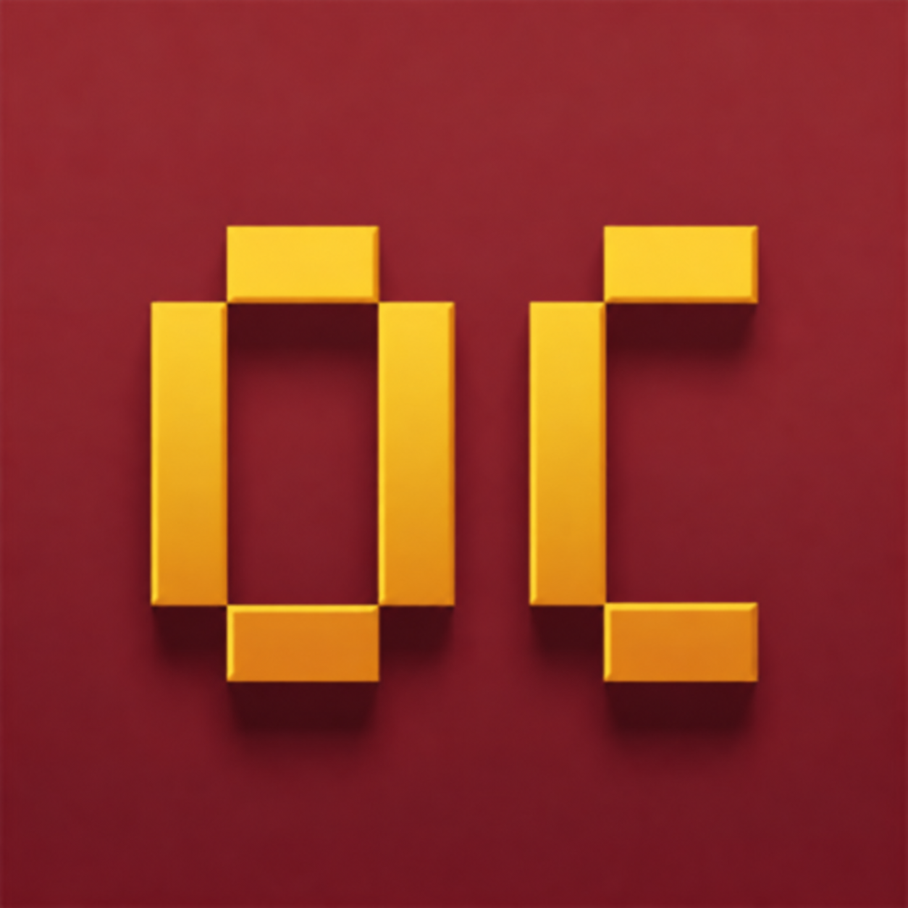

<p align="center">
  
</p>

<h1 align="center">OptiClaude</h1>

A lean, tested starter kit for [Claude Code](https://code.claude.com/docs). One command sets up any project with:
- a short CLAUDE.md containing only **commands that were actually run**,
- safe permissions,
- verify, handoff and lesson skills,
- a cheap log-reading subagent,
- a format hook,
- and a status line that shows context, cost and cache use.

It installs **no** plugins, MCP servers or third-party frameworks. Everything it adds is plain Claude Code configuration that you can read and edit.

> **Disclaimer:** OptiClaude is an independent community project. It is not affiliated with, endorsed by, or sponsored by Anthropic. "Claude" and "Claude Code" are trademarks of Anthropic. The scripts edit configuration files. They back up anything they change, but run with `-DryRun` / `--dry-run` first if you want to see the changes. The software is provided as is, without warranty; see [LICENSE](LICENSE).

## Install (once per machine)

Clone the repo, then run from the repo folder:

```powershell
# Windows (PowerShell 5.1 or 7)
powershell -NoProfile -ExecutionPolicy Bypass -File .\setup.ps1 -Global
```
```bash
# macOS / Linux / Git Bash (needs jq or python3 to merge into an existing settings.json)
bash setup.sh --global
```

This adds `/opticlaude-setup` and a status line to `~/.claude`. Restart Claude Code afterwards.

## Set up a project

1. Open a **new** Claude Code session in the project and accept the folder trust prompt.
2. Type `/opticlaude-setup`.
3. Run `/clear`, review the diff, and commit `CLAUDE.md` and `.claude/`.

Claude runs `setup.ps1 -Target` / `setup.sh --target`, reads only the manifests, CI config and README, and then:
- fills in CLAUDE.md,
- runs every command it wrote down, to confirm it works,
- adds those commands to the permission allowlist,
- wires up the format hook if the project has a formatter.

It installs nothing and commits nothing. You can also skip the install and paste [BOOTSTRAP-PROMPT.md](BOOTSTRAP-PROMPT.md) into a session yourself.

**Walkthrough:** [docs/TUTORIAL.md](docs/TUTORIAL.md)

## What you get

| Added | What it does | Why |
|---|---|---|
| `CLAUDE.md` | Repo summary, verified commands, a "Verification" section, gotchas, compact instructions. Under 80 lines | [Keep it short; include only what Claude can't infer](https://code.claude.com/docs/en/best-practices) |
| `.claude/settings.json` | Allows your verified test, lint and build commands. Stops Claude's file tools from reading `.env*` files (except the example ones), `*.pem` files and `secrets/**` | Fewer prompts without skipping permissions |
| `/go [pr]` | Verify end to end → `/simplify` → report evidence. With `pr`: commit and open a PR | Letting Claude check its own work is the biggest quality lever |
| `/handoff` | Writes `.claude/handoff.md`, so you can `/clear` and continue in a fresh context | Context quality drops as the window fills |
| `/lesson [what went wrong]` | Turns a correction into one line in the right place and keeps CLAUDE.md lean | Mistakes don't repeat |
| `log-digger` subagent | Haiku reads big logs or test output and returns at most 30 relevant lines | Keeps the main context small and cheap |
| `.claude/hooks/format-edited.sh` | Formats only the file just edited. Never blocks Claude. Added only if the project has a formatter | Deterministic, and costs no model tokens |
| Status line (global) | `myapp \| Opus (high) \| ctx 23% 234k \| $0.41 \| cache 91% \| 5h 24%`. Context turns yellow at 200k tokens and red at 350k | See when to compact or clear |
| `/opticlaude-setup` (global) | The bootstrap command, generated from [BOOTSTRAP-PROMPT.md](BOOTSTRAP-PROMPT.md) | |

The skills are manual-only (`disable-model-invocation: true`), so they cost no context until you type them.

## Script options

| PowerShell | Bash | Meaning |
|---|---|---|
| `-Target <dir>` | `--target <dir>` | Install the project files. This is the default (current folder) when you pass neither target nor global |
| `-Global` | `--global` | Install the status line and `/opticlaude-setup` into the user folder |
| `-UserDir <dir>` | `--user-dir <dir>` | Use a different user folder (default `~/.claude`) |
| `-Force` | `--force` | Replace kit files that you've changed (they're backed up first) |
| `-DryRun` | `--dry-run` | Show what would change, and write nothing |

**Guarantees** (covered by the tests):
- CLAUDE.md is never overwritten.
- `settings.json` is merged: permission lists are combined, every other key is kept, and a backup is written to `.claude/backup/<timestamp>/` or `~/.claude/backup/` first.
- An existing `statusLine` is kept unless you pass `-Force`.
- Re-running is idempotent.
- Files that differ only in line endings (CRLF vs LF, common with Git on Windows) count as unchanged.

## Uninstall

- **Project:** delete `.claude/agents/log-digger.md`, `.claude/skills/{go,handoff,lesson}` and `.claude/hooks/format-edited.sh`. Remove the kit's lines from `.gitignore` and `.gitattributes`. To get your old settings back, restore `.claude/settings.json` from `.claude/backup/`.
- **User:** delete `~/.claude/statusline.ps1` (or `.sh`), the `statusLine` key in `~/.claude/settings.json`, and `~/.claude/skills/opticlaude-setup/`.

## Tests

```bash
bash tests/test.sh                                                       # setup.sh, status line, format hook
powershell -NoProfile -ExecutionPolicy Bypass -File tests/test.ps1       # setup.ps1, status line (Windows)
```
CI runs both on Windows, macOS and Linux ([.github/workflows/test.yml](.github/workflows/test.yml)).

## License

[MIT](LICENSE)
